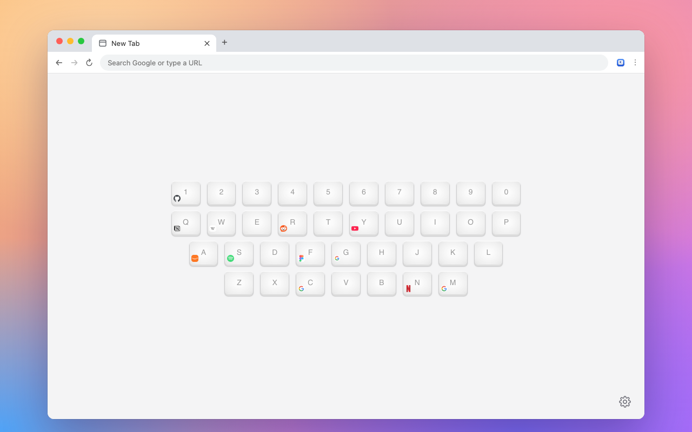

# Keyboard Start Page

**Every site, one key away.** Keyboard Start Page turns Chrome's new tab page into a keyboard. Give each key a website, then press the key to open it.

[**Add to Chrome**](https://chromewebstore.google.com/detail/keyboard-start-page/lcgabkjfibeakijbhicjjilchhmjaiid) · Free, no account, no tracking

## Features

- **One key per site.** Open a new tab and press <kbd>G</kbd> for Google, <kbd>Y</kbd> for YouTube, or any site you choose.
- **Easy to set up.** Click an empty key and type an address, or drag a link from a page, the address bar or the bookmarks bar onto a key.
- **Open from any page.** Turn on the website shortcut in settings, then hold your shortcut (Alt by default) and tap a key. It works on any website, without opening a new tab first.
- **Toolbar popup.** Click the extension icon to see your keyboard over any page. Press an empty key to save the page you're on.
- **Make it yours.** Use your own wallpaper at full quality, pick a background color, and choose a light, dark or system theme. Give keys short names if you like.
- **Edit many links at once.** The settings page lets you change, add and remove links in one go.
- **Backup.** Export your links and settings to a file and import them on another computer. Links also sync through your Chrome account.

## Tips

- Chrome puts the cursor in the address bar on every new tab. Press <kbd>Tab</kbd> or click the page before pressing a key, or turn on **Focus the page on new tabs** in settings.
- A key opens its link in the same tab, and <kbd>Shift</kbd> + key opens it in a background tab. You can change this in settings.
- Keys are normal links, so Ctrl/⌘ + click, middle click and right-click work as usual.
- The website shortcut doesn't work on Chrome's own pages or the Chrome Web Store, because Chrome blocks extensions there.
- Open settings with the gear in the bottom right corner of the new tab page. A short Help section at the top covers the basics.

## Privacy

Your links and settings stay in your browser and your Chrome account. Nothing is collected or sent anywhere. Site icons come from Google's favicon service. Read the full [privacy policy](PRIVACYPOLICY.md).

## Feedback

Found a bug or have an idea? [Open an issue](https://github.com/gyli/KeyboardStartPage/issues). If you like the extension, a review on the [Chrome Web Store](https://chromewebstore.google.com/detail/keyboard-start-page/lcgabkjfibeakijbhicjjilchhmjaiid) helps a lot.

Want to build or change it? See [CONTRIBUTING.md](CONTRIBUTING.md).

## Thanks

The original idea comes from [/t/32295](https://www.v2ex.com/t/32295). Early code was based on [qex/keystart](https://github.com/qex/keystart).

## License

MIT. See [LICENSE](LICENSE).
