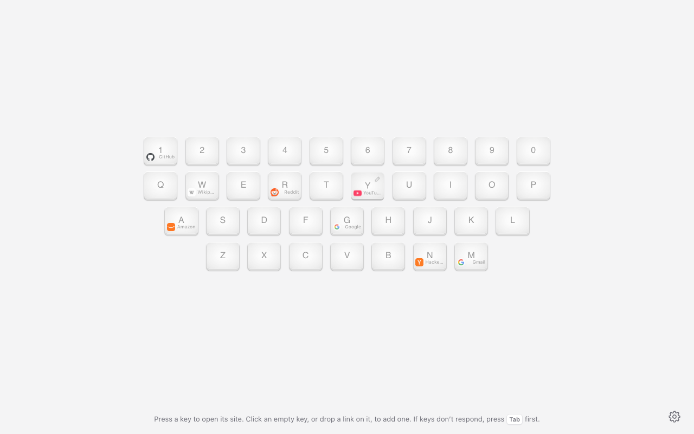

# Keyboard Start Page

A Chrome new tab page that shows a keyboard. Give each key a website, then press the key to open it.

## Install

Get it from the [Chrome Web Store](https://chromewebstore.google.com/detail/keyboard-start-page/lcgabkjfibeakijbhicjjilchhmjaiid). Requires Chrome 123 or later.

## Use

- **Add a link:** click an empty key and type the address, or drag a link (from a page, the address bar or the bookmarks bar) onto a key. You can give a key an optional name, shown in the key's corner.
- **Change or remove a link:** hover a key and click the pencil.
- **Open a link:** press the key, or click it.
- **Open links from any page:** turn on "Use a shortcut on websites" in settings (Chrome asks once for access to websites), then record a prefix: click Record, hold the keys together, and let go. The prefix needs Ctrl/⌃, Alt/⌥ or ⌘/Win, plus up to 3 other keys. While the prefix is held, tap a key to open its link, e.g. hold ⌥ and press G, or hold ⌃ + X + P and press G. Choose whether these links open in the same tab, a new tab, a background tab or a new window. It doesn't work on Chrome's own pages or the Chrome Web Store.
- **Toolbar popup:** click the extension's icon to open the keyboard over any page. Pressing an empty key there offers to add the page you're on.
- **Edit many links at once:** in settings, "Your links" lets you change names and addresses, add links, and remove several at once, then save them together.
- **Wallpaper, theme and more:** click the gear in the bottom right corner.

Chrome puts the cursor in the address bar on every new tab. Press <kbd>Tab</kbd> or click the page before pressing a key, or turn on **Focus the page on new tabs** in settings.

### Opening links

- **Keyboard:** a key opens its link in the same tab, and <kbd>Shift</kbd> + key opens it in a new background tab. Both can be changed in settings.
- **Mouse:** keys are normal links, so Chrome's usual shortcuts work: Ctrl/⌘ + click or middle click opens a background tab, Ctrl/⌘ + <kbd>Shift</kbd> + click opens a new tab, and <kbd>Shift</kbd> + click opens a new window. Right-click for more options.

## Development

There is no build step, and the extension has no dependencies. Playwright is used only for tests.

1. Open `chrome://extensions`, turn on **Developer mode**, click **Load unpacked**, and pick this folder.
2. After editing files, click the reload icon on the extension card and open a new tab.
3. Run `scripts/package.sh` to build the Web Store zip in `dist/`.

### Tests

Run `npm install` once, then `npm test`. Unit tests (`tests/unit`) use Node's built-in test runner. End-to-end tests (`tests/e2e`) load the extension into Chromium with Playwright. If Playwright asks for a browser, run `npx playwright install chromium`.

| Path | What it is |
|---|---|
| `newtab.html`, `src/newtab.js` | The new tab page |
| `popup.html`, `src/popup.js` | The toolbar popup |
| `options.html`, `src/options.js` | The settings page |
| `src/keyboard.js`, `styles/keyboard.css` | The keyboard, shared by the new tab page and the popup |
| `src/editor.js` | The edit link dialog |
| `src/links-editor.js` | "Your links" in settings: edit, add and remove many links at once |
| `src/open.js` | Opens links in the chosen tab or window |
| `src/prefix-shortcut.js` | Prefix format and the held-keys listener, shared by web pages, the new tab page and settings |
| `src/page-shortcuts.js` | Prefix shortcuts on web pages |
| `src/storage.js` | Settings: defaults, loading, saving, migration, backup, wallpaper |
| `src/url.js` | URL cleanup and display helpers |
| `src/theme.js`, `src/boot.js` | Theme handling |
| `service-worker.js` | Turns prefix shortcuts on and off, opens their links, caches site icons |
| `styles/base.css` | Colors and shared controls for light and dark mode |

Settings are stored in `chrome.storage.sync` with the same key names as v0.4 (`li_<key>`, `ShiftKey`, `bgColor`, ...), so updating keeps existing users’ links.

## Thanks

The original idea comes from [/t/32295](https://www.v2ex.com/t/32295). Early code was based on [qex/keystart](https://github.com/qex/keystart).

## License

MIT. See [LICENSE](LICENSE).
